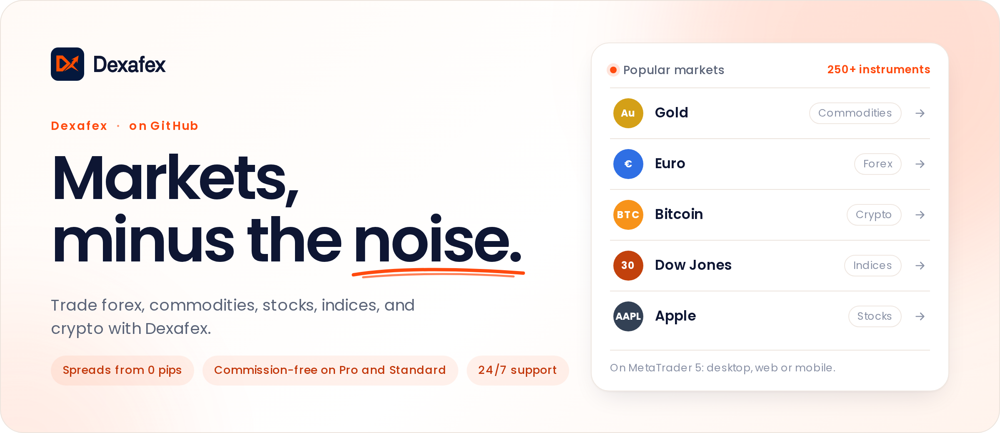
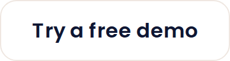
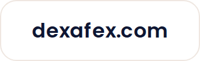
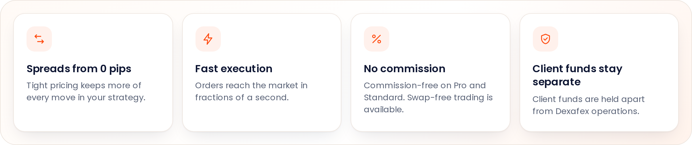
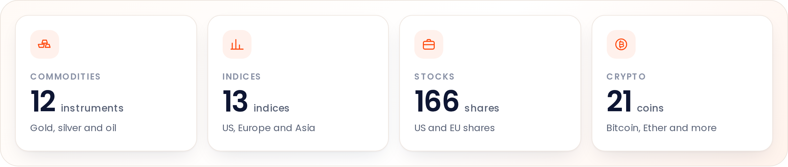
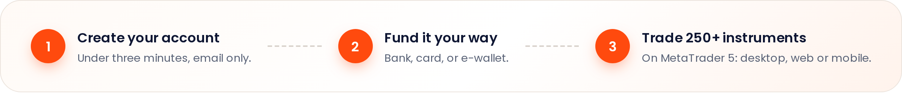
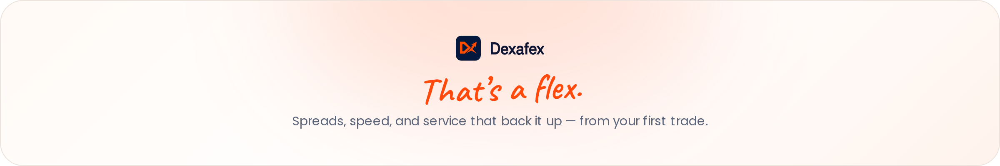

<a href="https://dexafex.com">
  <picture>
    <source media="(prefers-color-scheme: dark)" srcset="assets/hero-dark.png">
    
  </picture>
</a>

 

  <a href="https://dexafex.com/go/register"><picture><source media="(prefers-color-scheme: dark)" srcset="assets/btn-register-dark.png"></picture></a>
  &nbsp;
  <a href="https://dexafex.com/go/demo"><picture><source media="(prefers-color-scheme: dark)" srcset="assets/btn-demo-dark.png"></picture></a>
  &nbsp;
  <a href="https://dexafex.com"><picture><source media="(prefers-color-scheme: dark)" srcset="assets/btn-site-dark.png"></picture></a>

### Trade with confidence. Stay in control.

<picture>
  <source media="(prefers-color-scheme: dark)" srcset="assets/why-dark.png">
  
</picture>

### Stable and reliable pricing

<picture>
  <source media="(prefers-color-scheme: dark)" srcset="assets/markets-dark.png">
  
</picture>

### Three steps to your first trade

<a href="https://dexafex.com/go/register">
  <picture>
    <source media="(prefers-color-scheme: dark)" srcset="assets/steps-dark.png">
    
  </picture>
</a>

### Here on GitHub

This is where Dexafex publishes developer resources and open-source tools. Follow the organisation to see them first.

| | |
|---|---|
| **Website** | [dexafex.com](https://dexafex.com) |
| **Client area** | [my.dexafex.com](https://my.dexafex.com) |
| **Legal documents** | [dexafex.com/legal](https://dexafex.com/legal) |
| **Contact** | [support@dexafex.com](mailto:support@dexafex.com) |

 

<picture>
  <source media="(prefers-color-scheme: dark)" srcset="assets/signoff-dark.png">
  
</picture>

---

**Risk Warning:** Trading financial instruments is complex and comes with a high risk of losing funds rapidly due to leverage. To ensure that you fully understand the risks associated with margin trading, pay attention to our [Risk Disclosure](https://dexafex.com/go/risk-disclosure).

Dexafex International Ltd is registered under company number 2026-00654, with its registered address at Unit 1, La Place Creole Building, Rodney Village, Rodney Bay, Gros-Islet, Saint Lucia.

Restricted Jurisdictions: Australia, Canada, Cuba, Iran, Myanmar (Burma), North Korea, Syria and United States
